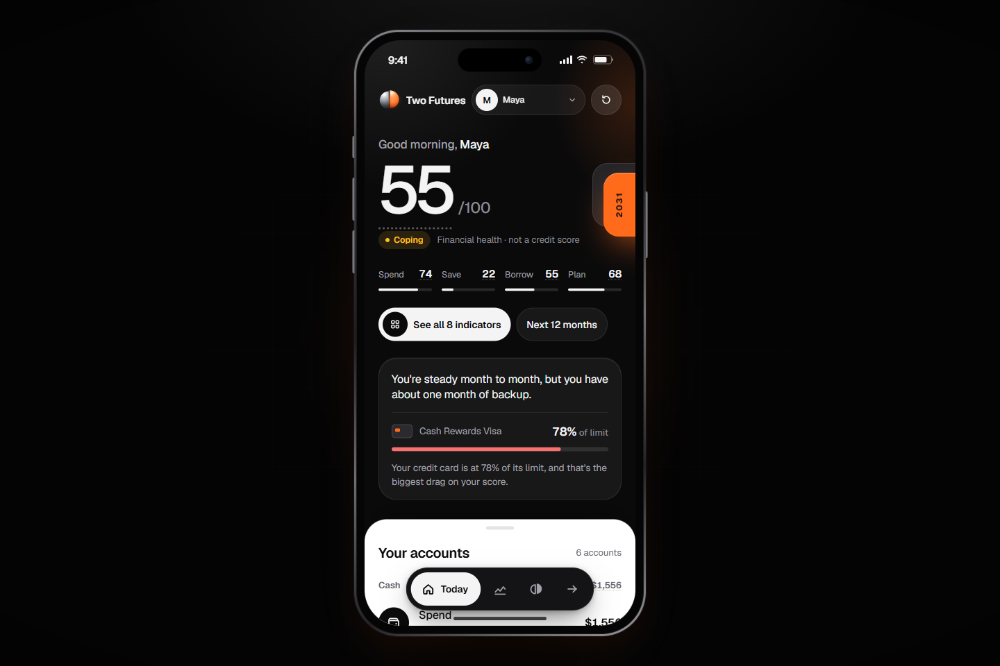
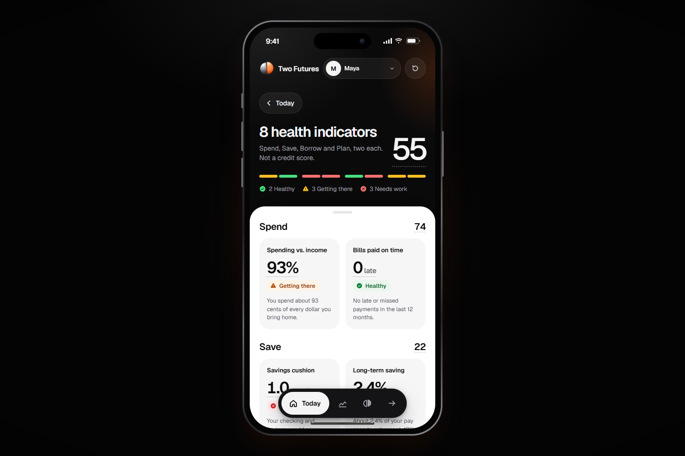
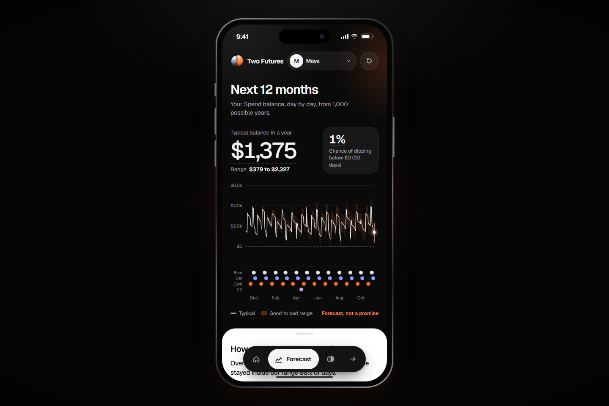
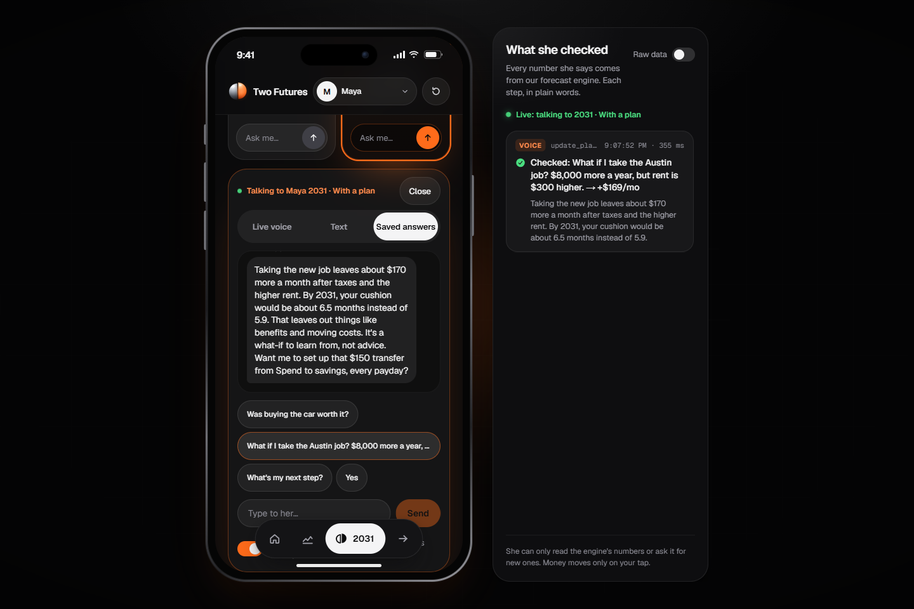
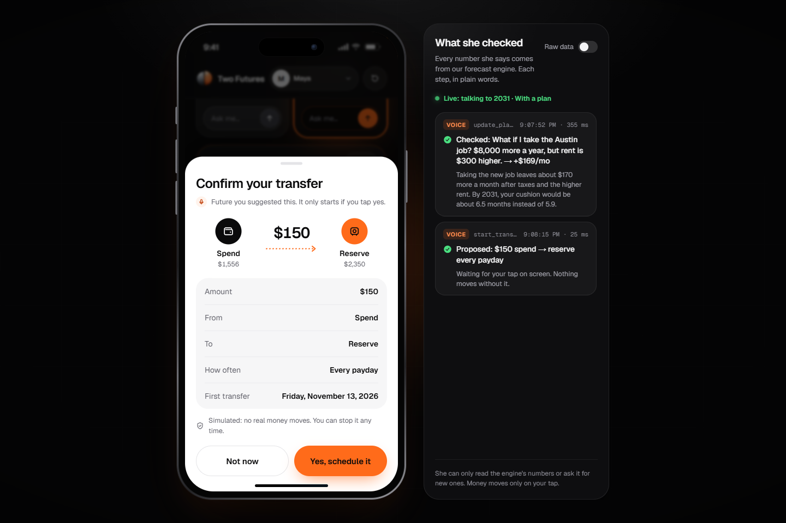
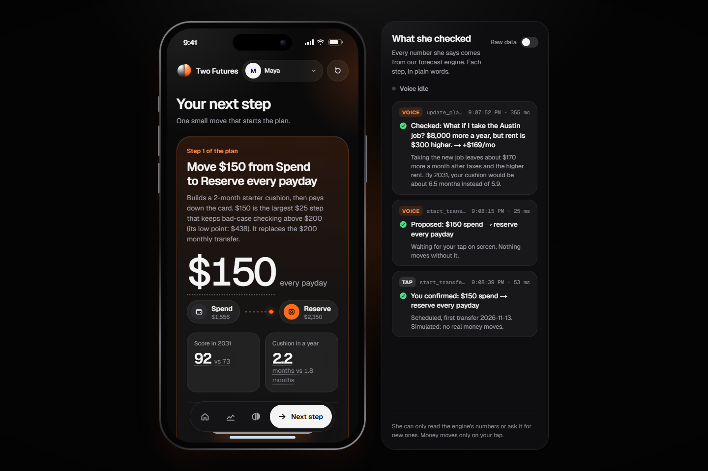
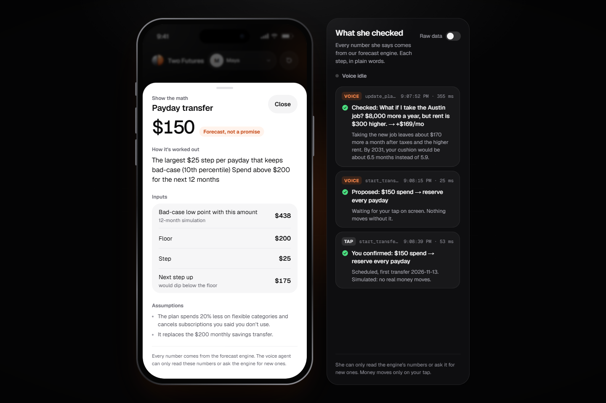
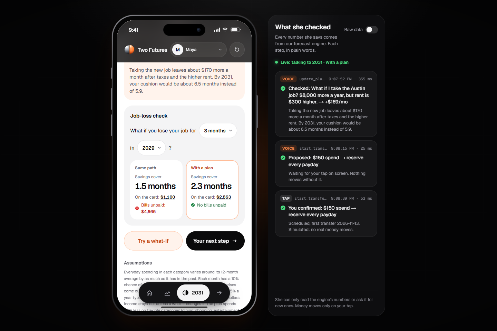
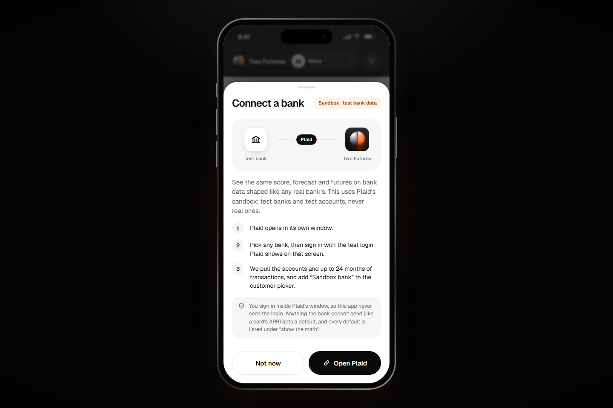
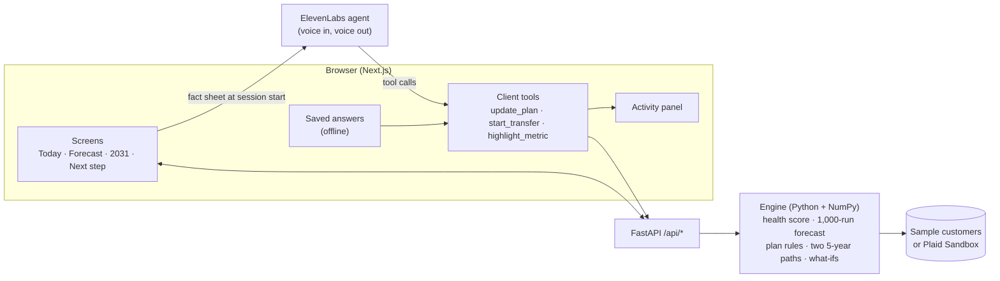

# Two Futures

**Meet the you of 2031, then take the first step today.**

Two Futures is a money app that shows your whole financial picture now, then lets you talk to two versions of yourself five years from now: one who kept doing what you do today, and one who followed a simple plan. You ask them questions, try decisions out loud ("What if I take the Austin job?"), and start the better path with one tap.

Every number comes from a forecast engine, not from the AI, and every number can show its math.

<p align="center">
  
</p>

> Built at HackUTD for PNC's 360° Financial Health Navigator challenge. A concept, not a PNC product. The sample customers are made up and transfers are simulated.

## Features

### Your whole picture, in one place
Checking, savings, CDs, retirement, car loans, cards and mortgages, grouped and summed, with a plain two-sentence summary of where you stand and the next 90 days of bills and paychecks.

### A health score you can understand
A 0–100 Financial Health Score built from 8 indicators across **Spend, Save, Borrow and Plan**, the same four pillars the Financial Health Network uses. Each indicator says why it scored the way it did. It's computed from your transactions, and it isn't a credit score.

<p align="center">
  
  
</p>

### A forecast that admits uncertainty
Your checking balance for the next 12 months, day by day, from 1,000 simulated years. You see the typical path, a good-to-bad range, your chance of dipping below $0, and when big bills land. A built-in backtest shows how often the real balance stayed inside the range.

<p align="center"></p>

### Talk to your future selves
Tap either future and ask anything, by live voice (ElevenLabs), text, or offline saved answers. Ask both the same question and hear two lives. Try a what-if (new job, move, big purchase, saving more, job loss, buying a home or car) and both the numbers and the story change.

A side panel shows **everything she checked**: each engine call, what went in and what came back, in plain words.

<p align="center"></p>

### One tap to start
The plan's first step is a single, sized-for-you move, like **$150 from Spend to savings every payday**: the largest $25 step that keeps your bad-case checking above $200 all year. Your future self can propose it, but nothing moves until you tap **Yes**, and you can stop it any time.

<p align="center">
  
  
</p>

### Show the math, everywhere
Tap any number to see its formula, inputs, thresholds and assumptions.

<p align="center">
  
  
</p>

### Bring your own (test) bank
Connect a bank through **Plaid Sandbox** and see the same score, forecast and futures on bank-shaped data. You sign in inside Plaid's own window with Plaid's test login, so the app never sees credentials.

<p align="center"></p>

## Meet Maya

The sample customer is Maya, 27, a nurse in Dallas. Today her score is 55 ("coping"): one month of cushion, and her card is at 78% of its limit.

| In 2031 | Score | Cushion | Card debt | IRA | Card interest since 2026 |
|---|---|---|---|---|---|
| Same path | 73 | 4.6 months | $3,900 | $15,692 | about $4,954 |
| With a plan | 92 | 5.9 months | $0 | $25,046 | about $962 |

Switch to **Jordan & Priya**, a household with all 8 account types, from the customer picker.

## How it works



**Code does the math, AI does the talking.** The voice agent never computes anything. It starts with a short fact sheet the engine wrote, and it can only get a new number by asking the app to run a tool, which calls the engine. Its prompt bans math and guessing, and the activity panel shows every call.

- **Health score** ([health.py](backend/app/engine/health.py)): 8 indicators, each scored on a straight line between two thresholds, computed from raw transactions.
- **Forecast** ([forecast.py](backend/app/engine/forecast.py), [sim.py](backend/app/engine/sim.py)): spending patterns learned from 12 months of history; 1,000 runs; a 10% monthly chance of a $300–$2,000 surprise. Both futures get the same surprises, so only the decisions differ. The [backtest](backend/app/engine/backtest.py) hides the last 91 days and checks the forecast against them (the real balance stayed in range on 88% of days for Maya, 97% for the household).
- **Plan rules** (no AI): a payday transfer builds a 2-month cushion, then pays debts highest-rate first, splits windfalls with the card, cancels subscriptions *you* say you don't use, trims flexible spending 20%, then fills savings to 6 months and sends the rest to retirement.
- **Real limits**: cards stop at their limit, and when money runs out (say, a long job loss) the shortfall shows up honestly as unpaid bills.
- **What-ifs** ([whatif.py](backend/app/engine/whatif.py)): pay changes after tax, moves, purchases, job loss, buying a home or car. Each returns new numbers and one ready-made sentence.
- **Bank data** ([plaid_adapter.py](backend/app/engine/plaid_adapter.py)): Plaid accounts, transactions and liabilities become the same customer model; anything the bank doesn't send gets a listed default.

## Trust and safety

- **No made-up numbers.** Engine-only facts, tool results with ready-made sentences, and a 10-question grounding test (`/grounding`): the live agent scores 10 of 10 grounded.
- **Nothing moves without your tap.** The agent can only propose; the API refuses anything without `confirmed: true`, limits amounts, and won't double-schedule. All transfers are simulated.
- **No product pushing.** No stocks, funds or products named; it points to a PNC banker for advice.
- **Honest AI.** No voice cloning or aged photos. She says she's an AI version of you, refuses a PIN, and points to 988 in a crisis.
- **Privacy.** The model sees a short fact sheet, never raw transactions. API keys and the Plaid access token stay on the server.

## Run it locally

Needs Node 22+ and [uv](https://docs.astral.sh/uv/).

```bash
npm run setup
```

```bash
npm run dev
```

Open http://localhost:3000. The API runs on port 8000 (docs at `/docs`); the browser only talks to Next, which forwards `/api/*`.

Optional keys go in `frontend/.env.local` (see [.env.example](.env.example)):

- **Voice:** add `ELEVENLABS_API_KEY`, then run `npm run agent:create` to create the agent and save `ELEVENLABS_AGENT_ID`. Without keys the app uses saved answers, fully offline.
- **Bank connection:** add Plaid sandbox keys (`PLAID_CLIENT_ID`, `PLAID_SECRET`, `PLAID_ENV=sandbox`). In Plaid's window, pick any bank and sign in with `user_good` / `pass_good` (code `1234` if asked).

## Deploy

The backend runs on Render (Blueprint in [render.yaml](render.yaml)) and the frontend on Vercel. Steps: [docs/DEPLOY.md](docs/DEPLOY.md).

## Tests

```bash
npm run check
```

Runs the back-end tests (149 passing: indicators and score from raw data, forecast shape, plan rules, both paths share the same surprises, what-ifs, transfer safety, Plaid adapter, backtest), plus the front-end type check and lint. Both 5-year paths compute in about 0.2 s.

Extra pages for checking a build: `/checklist` (pre-demo checks), `/grounding` (agent grounding test), `/voice-lab` (voice test bench), `/dev` (raw API responses).

## Project layout

| Folder | What's in it |
|---|---|
| `backend/app/engine/` | The engine: data, health score, forecast, plan rules, both paths, what-ifs, backtest, Plaid adapter |
| `backend/app/models.py` | The API contract. Front-end types are generated from it (`npm run gen:types`) |
| `frontend/src/components/` | Screens, voice session, saved answers, math sheet, activity panel, bank connection |
| `agent/` | ElevenLabs system prompt, tool definitions and setup guide |
| `data/` | Sample customers (`npm run data` regenerates them with a fixed seed) |
| `docs/` | Deploy guide, demo script, Devpost write-up, judge Q&A, screenshots |

Built with Next.js, React, Tailwind, Recharts, FastAPI, Python, NumPy, ElevenLabs and Plaid.
