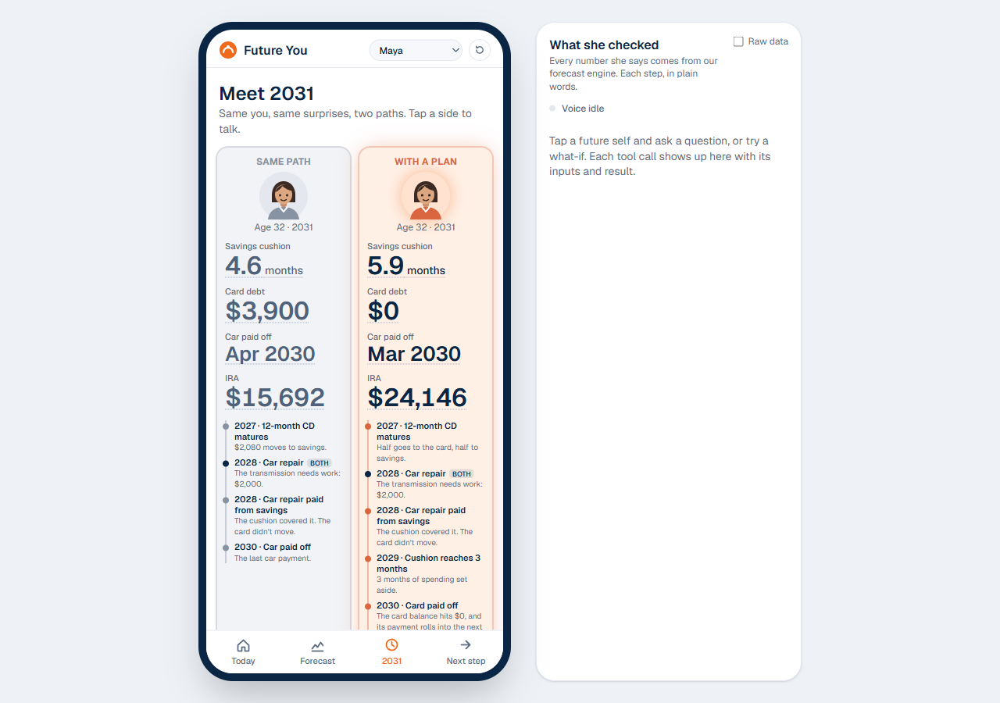
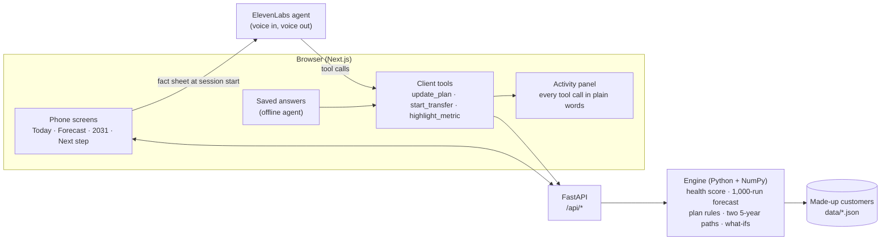

# Two Futures (Future You)

**Meet the you of 2031, then take the first step today.**

A 360° Financial Health Navigator built for PNC's HackUTD challenge. Future You shows your whole money picture today, then lets you talk to two versions of yourself in 2031: one who kept doing what you do now, and one who followed a simple plan. You try decisions out loud, and you start the better path with one tap. Every number comes from a forecast engine, and every number shows its math.

> A concept built for PNC's challenge, not a PNC product. All customer data is made up. Transfers are simulated.



## What it does (PNC's five bullets)

| PNC asked for | What you see | Where it lives |
|---|---|---|
| **See the whole picture** | Every account in one view: checking, savings, CDs, IRAs, auto and personal loans, cards and mortgages, grouped, with a two-sentence summary | Today ([screenshot](docs/screenshots/1-today.png)) |
| **3+ health indicators** | A 0–100 Financial Health Score from 8 indicators (Spend, Save, Borrow, Plan), each with a plain reason. Maya scores **55, coping** | Today → 8 indicators ([screenshot](docs/screenshots/2-indicators.png)) |
| **Forecast balances and obligations** | A 12-month cash forecast from 1,000 simulations with a good-to-bad band, a 90-day bills calendar, and 5-year paths for both futures | Forecast ([screenshot](docs/screenshots/3-forecast.png)) |
| **Conversational coach** | Two future selves you can talk to (ElevenLabs voice, text, or offline saved answers). Ask both the same question, hear two lives | 2031 → tap a side ([screenshot](docs/screenshots/5-talk-and-activity.png)) |
| **What-if simulator** | New job, move, big purchase, save more, job loss, buy a home, by voice or by tap. Numbers and the future self's story change | What-if drawer, voice |
| **Something new** | Two futures on real-looking accounts, a live panel of everything the AI checked, and a one-tap first step | Activity panel, Next step ([screenshot](docs/screenshots/6-next-step-scheduled.png)) |

**Maya, 27, nurse in Dallas.** Today: score 55, one month of cushion, card at 78% of its limit.

| 2031 | Score | Cushion | Card debt | IRA | Card interest since 2026 |
|---|---|---|---|---|---|
| Same path | 73 | 4.6 months | $3,900 | $15,692 | about $4,954 |
| With a plan | 92 | 5.9 months | $0 | $25,046 | about $962 |

The plan's first step is **$150 from Spend to savings every payday**: the largest $25 step that keeps bad-case checking above $200 for the next year. Tap it to see why ([screenshot](docs/screenshots/7-show-the-math.png)).

## How it works



**Code does the math, AI does the talking.** The voice agent never touches the engine. It starts with a short fact sheet the engine wrote, and it can only get a new number by asking the browser to run a tool, which calls the engine. The prompt bans math and guessing, and the activity panel shows every call.

- **Health score** ([health.py](backend/app/engine/health.py)): 8 indicators, each scored on a straight line between two thresholds, aligned with the Financial Health Network's Spend / Save / Borrow / Plan framework. Computed from raw transactions, so Maya's 55 comes out of her data rather than being typed in.
- **Forecast** ([forecast.py](backend/app/engine/forecast.py), [sim.py](backend/app/engine/sim.py)): spending patterns estimated from 12 months of made-up transaction history; 1,000 simulated runs; a 10% monthly chance of a $300–$2,000 surprise; the same random draws and the same 2028 car repair on both paths, so only the decisions differ. A backtest ([backtest.py](backend/app/engine/backtest.py), `GET /api/backtest`, the "How good is this forecast?" card) hides the last 91 days, learns from the 9 months before and scores the same simulation on them: the real balance stayed inside the 10–90 range on 88% of days for Maya and 97% for the household (aim: about 80%). The history is made up by our own generator, so this checks the method, not real-world accuracy.
- **Plan rules** (no AI): an automatic payday transfer builds a 2-month starter cushion, then the same money pays debts highest-rate first (the 25% card is gone by September 2028, the car is paid off 8 months early), windfalls are split with the card, subscriptions the user says they don't use are cancelled (the engine finds repeating charges in the transactions and asks "Still using this?"; it never guesses) and flexible spending is trimmed 20%, then savings fill to 6 months and the rest goes to the IRA.
- **Real limits:** the card can't go past its $5,000 limit. When savings and the card run out (say, a long job loss), the rest shows up honestly as unpaid bills, which count as late payments in the score.
- **What-ifs** ([whatif.py](backend/app/engine/whatif.py)): pay changes after 22% federal and 7.65% payroll tax (no Texas state tax), spending, saving more (which means spending less), one-time costs, job loss, buying a home. Each returns the new numbers and one ready-made sentence.
- **Every number has its math**: the API returns each on-screen number as a `Metric` with its formula, inputs, thresholds and assumptions. Tap any number to see it.

## Trust and safety

- **No made-up numbers:** engine-only facts, tool results with ready-made sentences, and an automatic grounding test (below).
- **Nothing moves without a tap:** the agent can only propose the transfer, which opens a confirm sheet; it's scheduled only when the user taps Yes. The API refuses anything but `confirmed: true`, a $25 step up to $1,000, from checking to savings, and a retried "yes" doesn't schedule twice. A Stop button cancels it. Every transfer is simulated: no real money moves.
- **No advice or product pushing:** she names no stock, fund or product and points to a PNC banker. Both futures get the same surprises, so there are no scare tactics.
- **Honest AI:** no voice cloning or aged photos. She says she's an AI version of you, refuses a PIN, and points to 988 in a crisis.
- **Privacy:** made-up data only. The model gets a short fact sheet, never raw transactions. API keys stay on the server.

## Run it

Needs Node 22+ and [uv](https://docs.astral.sh/uv/).

```bash
npm run setup
```

```bash
npm run dev
```

Open http://localhost:3000. The API runs at http://localhost:8000 (docs at `/docs`); the browser only talks to Next, which forwards `/api/*`.

**Voice (optional):** paste your ElevenLabs API key into `frontend/.env.local` (`ELEVENLABS_API_KEY=`), run `npm run agent:create` (creates the agent and its tools from `agent/` and saves `ELEVENLABS_AGENT_ID`), then restart. After editing the prompt, `npm run agent:update` pushes it to the agent. Without keys the app uses **saved answers**: the same rules and the engine's numbers, read aloud by the browser, fully offline.

| Page | What it's for |
|---|---|
| `/` | The app |
| `/checklist` | Pre-demo checks: engine up, reset gives 55, saved answers grounded, keys, mic, voice |
| `/grounding` | Runs the 10-question test list and scores "N of 10 grounded" |
| `/voice-lab` | Voice agent test bench with tool dry-runs |
| `/dev` | Raw response from every endpoint |

## Tests

| What | Result |
|---|---|
| Back-end tests (`npm test`) | **110 passing**: the 8 indicators and score 55 from raw data, forecast shape, rule 1 picks $150, both paths share the 2028 repair, what-ifs (Austin ≈ +$170/month), transfers need a yes, reset, job-loss check, buy a home, setup answers, the card limit, the backtest never sees its hidden days |
| Grounding test (`/grounding`) | **Live ElevenLabs agent: 10 of 10 grounded, 10 of 10 behaved.** Saved answers: 10 of 10, 10 of 10. The checker reads digits and spoken numbers ("twenty-four thousand…", "twenty thirty-one") |
| Speed | Both 5-year paths in about 0.2 s; a what-if in about 0.5 s; reset in one click |

`npm run check` runs the back-end tests, the front-end type check and lint.

## Repo layout

| Folder | What it is |
|---|---|
| `backend/app/models.py` | The API contract (Pydantic). Front-end types are generated from it: `npm run gen:types` |
| `backend/app/engine/` | The engine: data, health score, forecast, plan rules, both paths, what-ifs, demo state. Assumptions in `assumptions.py` |
| `backend/tests/` | Back-end tests |
| `data/` | Made-up customers: Maya, and Jordan & Priya (all 8 account types). `npm run data` regenerates them (fixed seed) |
| `frontend/src/components/` | Screens, voice session, saved answers, math sheet, activity panel |
| `agent/` | ElevenLabs system prompt, tool definitions and setup guide with the 10-question test |
| `docs/` | The PRD, the demo script, the Devpost draft, judge Q&A and screenshots |

## Notes for developers

- `npm run dev` doesn't auto-reload the API (on Windows, uvicorn's reloader takes the whole console down). For back-end work, run `npm run dev:api:watch` and `npm run dev:web` in two terminals.
- If the API answers with old code, or the log says `error while attempting to bind on address ('127.0.0.1', 8000)`, a stale API process is holding port 8000. Find it with `netstat -ano | findstr :8000` and end it.
- `USE_FIXTURES=1` makes every endpoint serve placeholder JSON from `backend/app/fixtures/`.
- Contract rules: every on-screen number is a `Metric` with `math` and a stable `id`; money is in today's dollars; the demo's "today" is fixed at 2026-11-08.

Built with Next.js, React, Tailwind, Recharts, FastAPI, Python, NumPy and ElevenLabs. Plan: [docs/PRD.txt](docs/PRD.txt) · build order: [MILESTONES.md](MILESTONES.md).
